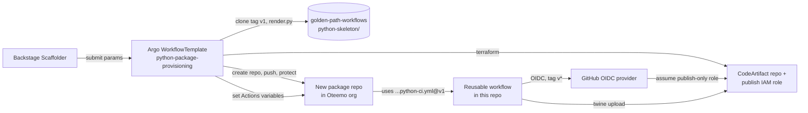

# golden-path-workflows

The CI/CD half of the Backstage "golden path" for Python packages (backstage-app #49).
It holds two things:

| Path | What it is |
|---|---|
| `.github/workflows/python-ci.yml` | The **reusable** CI/CD workflow every generated package calls |
| `python-skeleton/` | The Python package skeleton the Argo provisioning workflow copies into each new repo |
| `scripts/render.py` | Fills the skeleton's placeholders. Stdlib only |

The Argo provisioning workflow (creates the repo, Terraform for CodeArtifact and the publish role,
repo variables, teardown) is a separate piece owned by Prudvi.

## How it fits together



## The pipeline (`python-ci.yml`)

On every pull request and push to `main`: **ruff** (lint + format check), **mypy** (strict),
**pytest** with a coverage threshold (default 80%), **pip-audit** on the package's dependencies,
then **build** sdist and wheel (`twine check`). On a pushed tag `v*`, and only when publishing is
enabled, it also **publishes to CodeArtifact**: it checks the tag matches the built version,
assumes the publish role through GitHub OIDC, and runs `twine upload`. No access keys or tokens are stored.

Inputs (all have defaults): `python-version`, `coverage-threshold`, `publish`, `aws-region`,
`role-arn`, `codeartifact-domain`, `codeartifact-repository`.

## Contract with the Argo workflow

Set on each generated repo as **Actions variables** (not secrets):

| Variable | Value |
|---|---|
| `AWS_REGION` | `us-east-1` |
| `AWS_ROLE_ARN` | the `publish_role_arn` output |
| `CODEARTIFACT_DOMAIN` | CodeArtifact domain |
| `CODEARTIFACT_REPOSITORY` | the `codeartifact_repo` output |
| `PUBLISH_ENABLED` | `true` or `false`, from the `publish_enabled` parameter |

The publish role's OIDC trust must allow the new repo's **version tags** (`refs/tags/v*`), and use the
repository's real subject format (see `infra/modules/github-oidc` in backstage-app).

To use the skeleton, clone this repo at the pinned tag and run:

```bash
python -I scripts/render.py --package-name <name> --description "<text>" \
  --owner <group:default/team> --python-version 3.12 --out <dir>
```

It validates the name (PEP 508) and fails on any unreplaced placeholder.

## Versioning and rollout

- This repo uses semantic versioning, tagged `vMAJOR.MINOR.PATCH`, plus a moving major tag `v1`.
- Generated repos call `@v1`. Backwards-compatible fixes and additions: release `v1.x.y`, then move `v1`
  (`git tag -f v1 <sha> && git push -f origin v1`). Every generated repo picks it up on its next run,
  with no edits to those repos.
- Breaking changes (renamed inputs, removed jobs): release `v2`. Repos move when their caller changes `@v1` to `@v2`.
- A generated **package** is versioned separately: bump `version` in `pyproject.toml`, merge, tag `vX.Y.Z`.
  The tag publishes. Pre-releases use PEP 440 versions (`0.2.0rc1`, tag `v0.2.0rc1`).

## Teardown

Removing a demo package's CodeArtifact repo and publish role is part of the Argo side (Prudvi's teardown
workflow). To also remove the GitHub repo: `gh repo delete Oteemo/<package-name>`.

## Demo script (CI/CD part)

1. Submit the provisioning workflow (or run it from Backstage) for `demo-pkg`.
2. Open the new repo: confirm the first CI run is green (lint, types, tests, build, scan).
3. Bump the version, merge, then `git tag v0.1.0 && git push origin v0.1.0`. Watch **Publish to CodeArtifact** succeed.
4. In a clean venv:
   `aws codeartifact login --tool pip --domain <domain> --repository <repo> && pip install demo-pkg`.
5. Change `python-ci.yml` here, move `v1`, and re-run CI in the generated repo to show the rollout.
6. Run the teardown workflow.

## One-time setup

- Settings > Actions > General > Access: **Accessible from repositories in the Oteemo organization**
  (this repo is private).
- Tag `v1` once the first version is merged: `git tag v1 && git push origin v1`.
