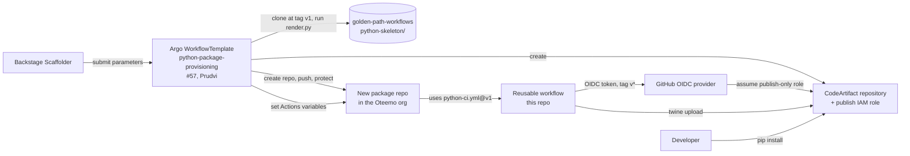
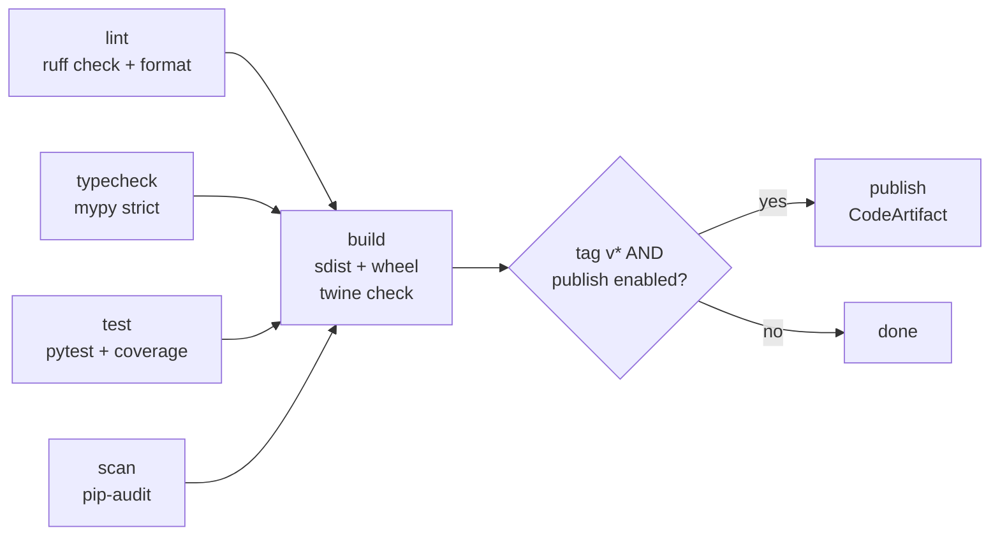
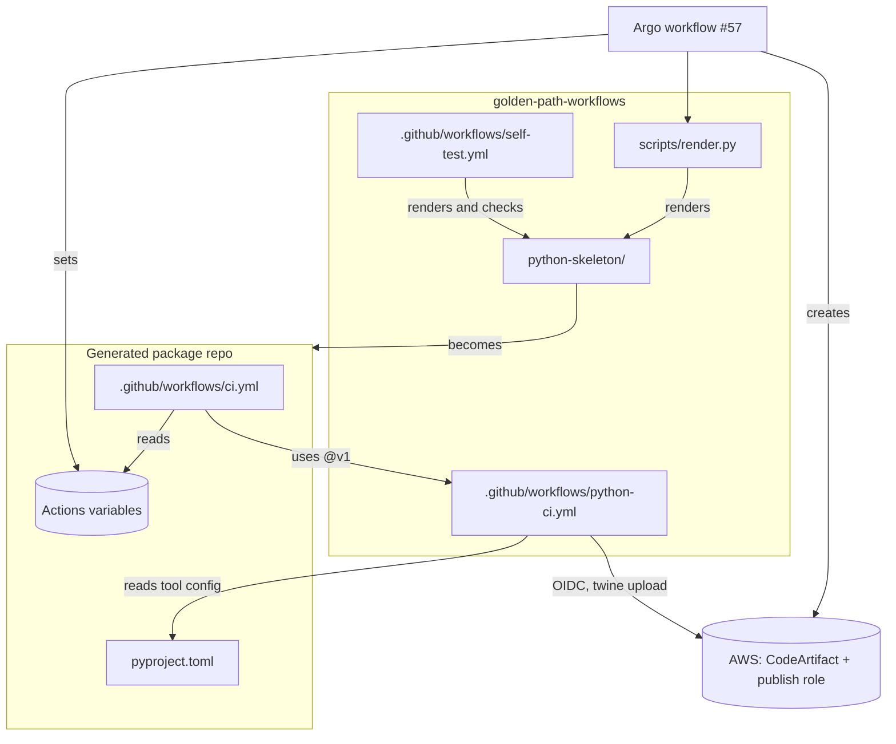

# Golden-path CI/CD for Python packages: how it works

Explains the CI/CD half of the Backstage golden path for Python packages (backstage-app issue #49, this part is #56): the reusable workflow, the package skeleton, how a new repo gets its pipeline, and how a package reaches CodeArtifact. The Argo provisioning half (#57, owned by Prudvi) is described only as the interface this repo expects.

The diagrams use [Mermaid](https://mermaid.js.org/), which GitHub renders in Markdown.

## 1. What this repo does

Every generated Python package gets the same pipeline with no copied logic. The package's repo holds a ~20-line caller workflow. The real pipeline lives here in one reusable workflow, so fixing or improving it is one change in this repo, rolled out by moving a tag.

| Piece             | Path                              | What it is                                                                                |
| ----------------- | --------------------------------- | ----------------------------------------------------------------------------------------- |
| Reusable workflow | `.github/workflows/python-ci.yml` | Lint, types, tests, dependency scan, build, and publish to CodeArtifact on a version tag  |
| Package skeleton  | `python-skeleton/`                | The starting files every generated package receives                                       |
| Renderer          | `scripts/render.py`               | Fills in the skeleton's placeholders. Standard library only                               |
| Self-test         | `.github/workflows/self-test.yml` | Proves the skeleton still renders and passes the pipeline, and lints the workflow files   |

## 2. End-to-end design



Key points:

- **One pipeline, many repos.** Generated repos call `python-ci.yml@v1`. They never edit pipeline logic.
- **No stored credentials.** Publishing uses GitHub OIDC to assume a role that can only publish to that package's CodeArtifact repository.
- **Two halves with a contract.** This repo provides the workflow and skeleton. The Argo workflow runs them, creates the AWS resources and sets the repo variables (section 6).

## 3. The pipeline: `python-ci.yml`

Runs on every pull request and every push to `main` (set by the caller). The four checks run in parallel, then `build` runs, then `publish` only on a version tag.



| Job         | Tool                                                                    | Fails when                                                                                  |
| ----------- | ----------------------------------------------------------------------- | ------------------------------------------------------------------------------------------- |
| `lint`      | `ruff check .` and `ruff format --check .`                              | Lint errors or unformatted code                                                             |
| `typecheck` | `mypy src` (strict, set in the package's `pyproject.toml`)              | Any type error                                                                              |
| `test`      | `pytest --cov --cov-fail-under=<threshold>`                             | A test fails, or coverage is below the threshold (default 80%)                              |
| `scan`      | `pip-audit .`                                                           | A known vulnerability in the package's runtime dependencies (not the dev tools)             |
| `build`     | `python -m build`, `twine check dist/*`, uploads `dist/` as an artifact | The package does not build or its metadata is invalid. Needs all four checks green          |
| `publish`   | See below                                                               | Misconfiguration, tag and version mismatch, or AWS denies the role                          |

### Publish job

Runs only when the caller passes `publish: true` **and** the ref is a tag starting with `v`. A branch or PR run never publishes.

1. **Fail early** if `role-arn`, `codeartifact-domain` or `codeartifact-repository` is empty.
2. Download the built `dist/` artifact, so it publishes exactly what was tested.
3. **Tag must match the version:** tag `v0.2.0` must equal the wheel's version `0.2.0`, otherwise it fails with a message to bump `pyproject.toml` and tag again.
4. Assume the publish role through OIDC (`aws-actions/configure-aws-credentials`).
5. `aws codeartifact login --tool twine`, then `twine upload --repository codeartifact dist/*`. The short-lived (12 hour) token is never printed.

### Inputs

All inputs have defaults. The caller passes them.

| Input                     | Default     | Meaning                           |
| ------------------------- | ----------- | --------------------------------- |
| `python-version`          | `3.12`      | Python version for every job      |
| `coverage-threshold`      | `80`        | Minimum total coverage, percent   |
| `publish`                 | `false`     | Publish when a `v*` tag is pushed |
| `aws-region`              | `us-east-1` | Region of the CodeArtifact domain |
| `role-arn`                | empty       | Publish-only IAM role to assume   |
| `codeartifact-domain`     | empty       | CodeArtifact domain name          |
| `codeartifact-repository` | empty       | CodeArtifact repository name      |

The caller must grant `permissions: { contents: read, id-token: write }`, because a called workflow can never hold more permission than its caller.

## 4. The skeleton and the renderer

### What a generated package contains

| File                                                           | Purpose                                                                                                                  |
| -------------------------------------------------------------- | ------------------------------------------------------------------------------------------------------------------------ |
| `pyproject.toml`                                               | Hatchling build, `src/` layout, dev tools (ruff, mypy, pytest, pytest-cov), strict mypy, ruff rules, coverage config     |
| `src/<module>/`                                                | Sample module (`greeting.py`) and the `py.typed` marker                                                                  |
| `tests/test_greeting.py`                                       | Sample tests, so the first run is green                                                                                  |
| `.github/workflows/ci.yml`                                     | The short caller workflow that uses `python-ci.yml@v1`                                                                   |
| `.github/dependabot.yml`                                       | Weekly pip and GitHub Actions updates                                                                                    |
| `.github/pull_request_template.md`, `CODEOWNERS`, `.gitignore` | Repo hygiene. CODEOWNERS is the owner passed to the renderer                                                             |
| `catalog-info.yaml`                                            | Backstage `Component` (type `library`, lifecycle `experimental`)                                                         |
| `mkdocs.yml`, `docs/index.md`                                  | Starter TechDocs site                                                                                                    |
| `README.md`                                                    | Package readme                                                                                                           |

### The caller workflow

```yaml
jobs:
  ci:
    uses: Oteemo/golden-path-workflows/.github/workflows/python-ci.yml@v1
    with:
      python-version: '<rendered>'
      publish: ${{ vars.PUBLISH_ENABLED == 'true' }}
      aws-region: ${{ vars.AWS_REGION }}
      role-arn: ${{ vars.AWS_ROLE_ARN }}
      codeartifact-domain: ${{ vars.CODEARTIFACT_DOMAIN }}
      codeartifact-repository: ${{ vars.CODEARTIFACT_REPOSITORY }}
```

It triggers on pull requests, pushes to `main`, and tags `v*`.

### Rendering: `scripts/render.py`

```bash
python -I scripts/render.py --package-name <name> --description "<text>" \
  --owner <group:default/team> --python-version 3.12 --out <dir>
```

It copies `python-skeleton/` to `--out`, replaces `{{package_name}}`, `{{module_name}}`, `{{description}}`, `{{owner}}` and `{{python_version}}`, and renames `src/__module_name__` to `src/<module_name>` (the package name with `-` and `.` turned into `_`). It exits with an error when:

- the name is not a valid PEP 508 name, or the Python version is not like `3.12`;
- the description or owner spans more than one line;
- the output directory exists and is not empty;
- any placeholder is left unreplaced after rendering.

## 5. File dependency map



| File                                       | Used by                                                                         | Must stay in sync with                                                                   |
| ------------------------------------------ | ------------------------------------------------------------------------------- | ---------------------------------------------------------------------------------------- |
| `.github/workflows/python-ci.yml`          | Every generated repo, through `@v1`                                             | The caller workflow's input names; the tool config in the skeleton's `pyproject.toml`    |
| `python-skeleton/.github/workflows/ci.yml` | Generated repos                                                                 | The inputs and variable names of `python-ci.yml`                                         |
| `python-skeleton/pyproject.toml`           | The pipeline (`pip install -e ".[dev]"`, `mypy src`, pytest and ruff config)    | The job commands in `python-ci.yml` (dev dependencies, `src/` layout)                    |
| `scripts/render.py`                        | The Argo workflow, `self-test.yml`                                              | The placeholders used in the skeleton                                                    |
| `.github/workflows/self-test.yml`          | Pull requests and pushes to `main` in this repo                                 | The skeleton and the renderer                                                            |

## 6. Contract with the Argo workflow

The Argo workflow (owned by Prudvi, #57) does the following for each package.

| Step                  | Detail                                                                    |
| --------------------- | ------------------------------------------------------------------------- |
| Fetch the skeleton    | Clone this repo at the pinned tag (`v1`) and run `render.py`              |
| Create the repo       | In the `Oteemo` org: push the rendered files and set up protection        |
| Create AWS resources  | The package's CodeArtifact repository and publish role                    |
| Set Actions variables | The table below. They are variables, not secrets                          |

| Variable                  | Value                                                   |
| ------------------------- | ------------------------------------------------------- |
| `AWS_REGION`              | `us-east-1`                                             |
| `AWS_ROLE_ARN`            | The publish role's ARN                                  |
| `CODEARTIFACT_DOMAIN`     | CodeArtifact domain                                     |
| `CODEARTIFACT_REPOSITORY` | The package's CodeArtifact repository                   |
| `PUBLISH_ENABLED`         | `true` or `false`, from the `publish_enabled` parameter |

## 7. Versioning and rollout

- This repo is versioned `vMAJOR.MINOR.PATCH` with a moving major tag `v1`. Generated repos call `@v1`.
- **Compatible fix or addition:** release `v1.x.y`, then move `v1`: `git tag -f v1 <sha> && git push -f origin v1`. Every generated repo picks it up on its next run with no edits.
- **Breaking change** (renamed input, removed job): release `v2`. A repo moves when its caller changes `@v1` to `@v2`.
- **A generated package** is versioned separately: bump `version` in `pyproject.toml`, merge, tag `vX.Y.Z`. The tag publishes. Pre-releases use PEP 440 versions (`0.2.0rc1`, tag `v0.2.0rc1`).

Because moving `v1` changes what every generated repo runs, who may move it matters (see section 10).

## 8. Demo script (CI/CD part)

1. Run the provisioning workflow (or start it from Backstage) for `demo-pkg`.
2. Open the new repo and confirm the first CI run is green (lint, types, tests, scan, build).
3. Bump the version, merge, then `git tag v0.1.0 && git push origin v0.1.0`. Watch **Publish to CodeArtifact** succeed.
4. In a clean virtual environment: `aws codeartifact login --tool pip --domain <domain> --repository <repo> && pip install demo-pkg`
5. Change `python-ci.yml` here, move `v1`, and re-run CI in the generated repo to show the rollout.
6. Run the teardown workflow.

## 9. Teardown

Removing the package's CodeArtifact repository and publish role is part of the Argo side (Prudvi's teardown workflow). To also remove the GitHub repo: `gh repo delete Oteemo/<package-name>`.

## 10. One-time setup, status and known gaps

One-time setup:

- Settings → Actions → General → Access: **Accessible from repositories in the Oteemo organization** (this repo is private, and generated repos must be able to call the workflow).
- Create the `v1` tag once the first version is merged: `git tag v1 && git push origin v1`.

Status (as of 13 Nov 2026):

| Area                                                                                                                                         | State                                                                                                                                                                                                                                                                  |
| -------------------------------------------------------------------------------------------------------------------------------------------- | ---------------------------------------------------------------------------------------------------------------------------------------------------------------------------------------------------------------------------------------------------------------------- |
| Reusable workflow, skeleton, renderer, self-test                                                                                             | Done                                                                                                                                                                                                                                                                   |
| Branch protection on `main` and protection of `v*` tags                                                                                      | **Not configured.** A tag triggers a publish and moving `v1` affects every generated repo. Waiting on who may move `v*` tags                                                                                                                                           |
| OIDC subject format                                                                                                                          | **Not verified.** The role defaults to `repo:<org>/<repo>:ref:refs/tags/v*`, but this org's repos present the immutable form that embeds numeric owner and repo ids. Read the real subject from the first generated repo and set the role's allowed subjects to match, or the publish job is denied |
| GitHub App read access to this repo (so Argo can fetch the skeleton)                                                                         | Not confirmed                                                                                                                                                                                                                                                          |
| First CI run of a real generated repo, a CodeArtifact publish with a clean `pip install`, TechDocs build, demo by someone who did not build it | Blocked on the Argo workflow (#57)                                                                                                                                                                                                                                     |

Other limits: the self-test downloads `actionlint` from its `main` branch (unpinned), and nothing tests the publish job against real AWS yet.

## 11. Security notes

- **No stored credentials.** Publishing uses GitHub OIDC; the role trusts version-tag subjects for one repository.
- **Publish-only role.** It can publish to one CodeArtifact repository and nothing else.
- **Pinned actions.** Third-party actions are pinned to commit SHAs.
- **Least privilege in the workflow.** Default permissions are `contents: read`. `id-token: write` is granted to the publish job only.
- **Inputs go through `env`**, not directly into script text, in the publish job.
- **Publishes exactly what was tested.** The publish job uploads the `dist/` artifact built by the build job, after the tag and version check.

## 12. Troubleshooting

| Symptom                                                                 | Likely cause                                                                                        | Fix                                                                                              |
| ----------------------------------------------------------------------- | --------------------------------------------------------------------------------------------------- | ------------------------------------------------------------------------------------------------ |
| Caller run fails at once: workflow not found, or access denied          | This repo's Actions access does not allow the org, or the tag `v1` does not exist                   | Set Actions access to the Oteemo org; create the `v1` tag                                        |
| `Publishing is enabled but ... is empty`                                | A repo variable is missing                                                                          | Check `AWS_ROLE_ARN`, `CODEARTIFACT_DOMAIN` and `CODEARTIFACT_REPOSITORY` on the generated repo  |
| `Tag vX does not match the built version Y`                             | `pyproject.toml` version was not bumped before tagging                                              | Bump, merge, delete the bad tag, tag again                                                       |
| `Not authorized to perform sts:AssumeRoleWithWebIdentity` on publish    | The role's trusted subject does not match the repo's real OIDC subject, or the run is not a `v*` tag | Compare the subject in the run with the role's trust policy and correct the allowed subjects     |
| `ruff format --check` fails on the first run                            | Edits are not formatted                                                                             | Run `ruff format .` and commit                                                                   |
| Coverage below threshold                                                | Tests do not cover enough                                                                           | Add tests, or change the threshold input deliberately                                            |
| `pip-audit` fails                                                       | A vulnerable runtime dependency                                                                     | Upgrade the dependency                                                                           |
| `render.py` fails with unreplaced placeholders                          | A new `{{placeholder}}` was added to the skeleton without updating the renderer                     | Add it to the `values` map in `render.py`                                                        |

## 13. Decisions

| Decision                                         | Reason                                                              |
| ------------------------------------------------ | ------------------------------------------------------------------- |
| Reusable workflow called at `@v1`                | One place to change the pipeline, with controlled rollout           |
| Moving major tag, semantic versions underneath   | Compatible fixes roll out at once, breaking changes are opt-in      |
| Publish only on `v*` tags and only when enabled  | A branch or PR can never publish; publishing is explicit            |
| OIDC publish-only role per package               | No stored keys, small blast radius                                  |
| CodeArtifact as the package registry             | Stays inside the AWS account and uses the same IAM model            |
| `render.py` uses only the standard library       | The Argo step can run it in any Python image                        |
| Self-test renders and runs the skeleton          | A broken skeleton is caught here, not in a new repo's first run     |
| Skeleton and pipeline live in one repo           | They change together, and tags version both                         |
