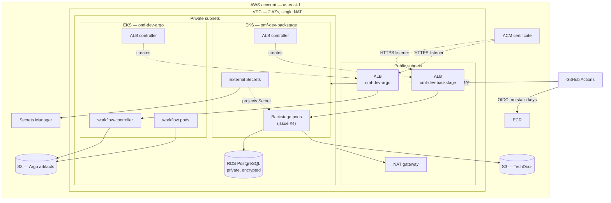

# Infrastructure — Backstage and Argo Workflows on EKS

Terraform for issue #5. Provisions the AWS infrastructure to run Backstage and
Argo Workflows on two EKS clusters, in a single account, single `dev`
environment, `us-east-1`.

Sized for a demo of 1–2 users. **Not sized or configured for production** — see
[Not production ready](#not-production-ready).

> **Status (29 Oct 2026):** applied to an Oteemo sandbox account as a proof of
> concept to demonstrate to OMF — not client infrastructure. 9 of 16 acceptance
> criteria are proven against live AWS. See [PROGRESS.md](PROGRESS.md) for the
> criterion-by-criterion record of what is built, what is proven, and what is not.

## In plain English

**What this builds.** The ground floor that the rest of the Backstage project
stands on. Nothing here is Backstage itself — it is the environment Backstage
and the automation engine will run in.

| What | Why it exists |
|---|---|
| **Two Kubernetes clusters** (EKS) | One runs **Backstage**, the developer portal. One runs **Argo Workflows**, the engine that runs automation jobs. Kept apart so a heavy job cannot slow the portal |
| **A Postgres database** | Backstage stores its data here. Private: reachable only from inside the network, never from the internet |
| **A container registry** (ECR) | Where the Backstage image is pushed and deployed from |
| **Two storage buckets** | One for generated documentation (TechDocs), one for workflow outputs |
| **Secrets** | The database password is generated and delivered into the cluster automatically. Six more slots — GitHub token, four Okta values, backend secret — exist and are delivered the same way, but **are empty until someone sets a value** |
| **Load balancers with HTTPS** | The "front doors". Uses a self-signed certificate, so browsers warn once — expected, because there is no domain |
| **A GitHub login for automation** | Lets GitHub Actions deploy without any stored passwords (OIDC), limited to specific branches and one environment |

**What this does not do.** It does not deploy Backstage (issue #4), set up Okta
sign-in (#2), load the catalog (#3), or build the Python golden path (#1). Those
build on this; the table below says what each can rely on.

**How we know it works.** `scripts/verify.sh` checks the live environment, and
[PROGRESS.md](PROGRESS.md) records each criterion as proven, partly proven, or
not yet — including the ones we got wrong along the way.

## What the other tickets can rely on

Facts about the live environment, and the rules each ticket needs to follow.
Values come from Terraform outputs (`terraform output` in `envs/omf-dev` and
`envs/omf-dev-workloads`), not from this page, so they cannot go stale here.

**Getting access.** The pipeline does not need any person to have AWS access.
GitHub Actions authenticates with the CI role (OIDC, no keys), pushes to ECR and
deploys to the `backstage` namespace; that role cannot touch any other ECR
repository or namespace in the account. Human access is only for debugging
(`kubectl logs`, pushing an image by hand), and is **optional**. Don't reach for
`AdministratorAccess`: the sandbox is shared with other stacks, and it can delete
all of them. (`PowerUserAccess` can delete them too; it just cannot touch IAM.) If someone needs `kubectl`, ask for a narrower permission set (e.g.
read-only) and we add an EKS access entry limited to the `backstage` namespace —
assigning permission sets is done in IAM Identity Center, outside this repo.

### Issue #4 — CI/CD pipeline for Backstage

| Need | What exists |
|---|---|
| Where to deploy | Cluster `omf-dev-backstage`, namespace `backstage` (already created) |
| Where to push the image | The `ecr_repository_url` output. Scan-on-push; untagged images expire after 14 days; the last 20 tagged are kept |
| How GitHub authenticates | The `github_actions_role_arn` output — **no access keys anywhere**. The workflow reads three repository variables, which need repo-admin to create: `AWS_ROLE_ARN` (that output), `ECR_REPOSITORY` (the `ecr_repository_url` output) and `AWS_REGION` (`us-east-1`). Working example: [`.github/workflows/aws-oidc-check.yml`](../.github/workflows/aws-oidc-check.yml) |
| Which workflows can assume it | Exact matches only: branches `dev` and `master`, **and** the GitHub Environment `dev`. A job that declares `environment: dev` presents a different identity than a branch push, so both are trusted. Pull requests and feature branches **cannot** assume it, on purpose **Note:** this repository issues *immutable* subject claims (`repo:Oteemo@<owner-id>/backstage-app@<repo-id>:…`), so the role trusts that form, set by `github_subject_prefix`. A role trusting the plain `repo:Oteemo/backstage-app` form is silently unassumable — read yours with `gh api repos/<org>/<repo>/actions/oidc/customization/sub --jq .sub_claim_prefix` **The Environment `dev` exists (created 30 Oct) and allows deployments only from the `dev` branch**; a run through it was verified to assume the role. Your workflow does not need it — it uses the branch subject. |
| What the role may do | Push to the one ECR repository; describe the two clusters; edit resources **inside the `backstage` namespace only**; read, write and delete objects in the TechDocs bucket (to publish built docs). Nothing cluster-wide, nothing in other namespaces |

**Rules for the Backstage deployment — please follow these:**

- **Name the Service `backstage`, port `7007`, in namespace `backstage`.** The
  load balancer is wired to exactly that. It does not matter whether the Service
  exists yet — the load balancer is created first and answers `503` until pods
  are ready behind it.
- **Do not create your own Ingress.** Terraform owns the Backstage Ingress and
  its load balancer, whose name is pinned so the hostname stays stable (Okta
  depends on it). A second Ingress would create a second load balancer.
- **Use ServiceAccount `backstage`**, annotated with the
  `backstage_service_account_annotation` output. That is what lets the pod reach
  the TechDocs bucket without credentials.
- **Read secrets from the Kubernetes Secrets that already exist** — do not
  create them. See the table below.
- **Smoke tests must skip certificate verification** (`curl -k`): the certificate
  is self-signed. The `smoke_test_tls_flag` output returns the flag.

### Secrets, and who sets them

All four live in AWS Secrets Manager under `omf-dev/backstage/` and are copied
into the `backstage` namespace automatically (refreshed hourly).

| Kubernetes Secret | Key (env var name) | AWS secret | Who fills it | State |
|---|---|---|---|---|
| `backstage-database` | `POSTGRES_HOST` `_PORT` `_USER` `_PASSWORD` `_DB` | `database` | Terraform | **Populated** |
| `backstage-okta-client-id` | `AUTH_OKTA_CLIENT_ID` | `okta-client-id` | Issue #2 | **Empty** |
| `backstage-okta` | `AUTH_OKTA_CLIENT_SECRET` | `okta-client-secret` | Issue #2 | **Empty** |
| `backstage-okta-domain` | `AUTH_OKTA_DOMAIN` | `okta-domain` | Issue #2 | **Empty** (`https://<org>.okta.com`, not the `-admin` URL) |
| `backstage-okta-api-token` | `OKTA_API_TOKEN` | `okta-api-token` | Issue #2 | **Empty** (org sync token, Read-only Administrator service user) |
| `backstage-github` | `GITHUB_TOKEN` | `github-token` | Issue #3 | **Populated and verified 29 Oct.** Read-only fine-grained token for `backstage-app` only: it reads that repo and is refused on three other private repos. Expires 28 Dec; see "Rotating the GitHub token" |
| `backstage-backend` | `BACKEND_SECRET` | `backend-secret` | Issue #4 | **Populated 30 Oct.** Random 32-byte value generated with `openssl` and stored without being displayed or logged by us. Anyone with Secrets Manager read access in this account could still read it (see below). The deploy reads it from this Secret and must not print it in logs |

To set one you need write access to that secret in the sandbox. That includes the
`PowerUserAccess` permission set as well as administrators, so the owner of each
integration (#2 Okta, #3 GitHub, #4 backend) may be able to do it themselves; a narrower
permission set that allows `secretsmanager:PutSecretValue` on `omf-dev/backstage/*` only
would be the least-privilege version. The value never touches the repo, state, or a plan:

```bash
aws secretsmanager put-secret-value \
  --secret-id omf-dev/backstage/okta-client-secret \
  --secret-string 'the-value'
```

**Who can read these values.** The CI role and the pods are scoped narrowly, but *people*
are not. Anyone with Secrets Manager read access in this sandbox can read all four. The
`PowerUserAccess` permission set (the one non-admin general set in the account, checked
with the IAM simulator) allows that, and also allows deleting clusters and VPCs — ours and
other teams' — and pushing to any ECR repository. It cannot create IAM roles and it has no
`kubectl` (only the administrator role is mapped into the clusters). So treat these values
as readable by everyone holding that set, rotate one if it is ever exposed, and note that
tightening the set is an account-level decision outside this repo.

Until a value exists its Kubernetes Secret does not appear and its
`ExternalSecret` reports `SecretSyncedError`. That is expected, not a fault —
checked, not assumed: IAM confirms the operator is allowed to read all four, and
the three empty ones have no stored version, so "no value" is the only possible
cause.

### Rotating the GitHub token

The GitHub token is a **fine-grained personal access token** with a 60-day expiry
(created 29 Oct 2026, **expires 28 Dec 2026**). When it lapses, catalog discovery fails
quietly rather than loudly, so renew it **before** then. Same steps as the first time:

1. **Create the new token** at GitHub → Settings → Developer settings → Fine-grained
   tokens. Resource owner **`Oteemo`**, repository access **only `backstage-app`**,
   permissions **Contents: read-only** and **Metadata: read-only** and nothing else,
   expiry 60 days. Remove any extra permissions GitHub adds by default (Artifact
   metadata, Codespaces metadata). Fill in the request message — this org requires an
   owner to approve fine-grained tokens, so it stays pending until they do. Copy the
   token straight away: GitHub shows it once.
2. **Store it** without it touching your shell history. Paste this command into the
   terminal **first** and do not press Enter, *then* copy the token, *then* press Enter.
   Copying the command after the token replaces the token on the clipboard, which is the
   mistake that makes the guard refuse. It strips whitespace and refuses anything that
   is not a `github_pat_` token:

   ```bash
   T=$(pbpaste | tr -d '[:space:]'); if [[ "${T:0:11}" == "github_pat_" && ${#T} -gt 60 ]]; then AWS_PROFILE=omf-dev aws secretsmanager put-secret-value --secret-id omf-dev/backstage/github-token --secret-string "$T" --query VersionId --output text; else echo "Clipboard does not hold a github_pat_ token, not storing"; fi; unset T
   ```

3. **Remove every other copy**: run `pbcopy < /dev/null`, delete the token from any text
   editor (and close the tab without saving — some editors remember unsaved tabs), and
   delete it from any clipboard-manager history.
4. **Let the cluster pick it up.** The `backstage-github` ExternalSecret refreshes hourly;
   to refresh now:
   `kubectl -n backstage annotate externalsecret backstage-github force-sync=$(date +%s) --overwrite`.
   Then check it shows `SecretSynced`. Check the key's shape, never print its value.
5. **Restart Backstage.** If the token is injected as an environment variable, which is
   how this README tells issue #4 to read it, a running pod keeps the old value until it
   restarts: `kubectl -n backstage rollout restart deployment/<backstage-deployment>`.
6. **Revoke the old token** on GitHub once the new one works. Leaving it alive until it
   expires defeats the point of rotating.

To confirm a token works and is scoped correctly, read the stored value into a shell
variable and print **only status codes**: the repo's `contents` endpoint should return
`200` for `backstage-app` and `404` or `403` for any repo the token was not granted.
Never print the token, and never paste it into a ticket or chat.

### Issue #2 — Okta

- The redirect URI is the `okta_redirect_uri` output (`envs/omf-dev-workloads`).
  Okta needs it **before** Backstage is deployed, which is why the load balancer
  is created ahead of the application.
- The hostname is stable **unless the Ingress is deleted and recreated** — then
  it changes and the Okta redirect URI and Backstage `baseUrl` must be updated.
- Okta accepts the self-signed certificate: the redirect happens in the browser
  and Okta checks only that the URI is `https://`.

### Issue #3 — Catalog seeding

- `GITHUB_TOKEN` is delivered through the `backstage-github` Secret above.
- The TechDocs bucket and the permission to use it (via the pod's
  ServiceAccount) exist — see the `techdocs_bucket` output.

### Issue #1 — Scaffolder to Argo handoff (issues #49 and #50)

- **Where Argo is.** The `argo_url` output. It is restricted by source address, and **the NAT
  gateway address is allowed automatically**, because Backstage reaches Argo over the public
  load balancer from inside the network. The portal gets the address as `ARGO_BASE_URL` (the
  repository variable of the same name, set from the `argo_url` output so no hostname lives in
  a file). The certificate is self-signed, so the infra layer exposes its public part
  (`ingress_certificate_pem`), the workloads layer puts it in a ConfigMap `argo-ca` in the
  Backstage namespace, and the chart points `NODE_EXTRA_CA_CERTS` at it. Certificate checks
  stay on. Do not disable them in app code.
- **How Backstage logs in.** Argo accepts one login mode here: `client`, a Bearer token that runs
  the request as that token's ServiceAccount. Backstage uses the ServiceAccount
  `backstage-argo-submitter` from the `argo-submitter` chart. The Argo UI therefore asks for a
  token. WorkflowTemplates are applied by an administrator with `kubectl`; no one else can
  create them.
- **What that identity can do.** In the `argo` namespace only: read the one WorkflowTemplate
  `python-package-provisioning`, and create, get, list and watch workflows. No delete, no
  secrets, no pods, nothing in other namespaces.
- **A limit RBAC alone cannot remove, closed by the controller.** Starting a run needs `create`
  on `workflows`, and `create` cannot be restricted by name. So the Argo controller is set to
  `workflowRestrictions.templateReferencing: Secure`: a workflow only runs if it references a
  WorkflowTemplate and its spec is the template's. An inline workflow, or one that overrides
  the ServiceAccount, is rejected. `scripts/verify.sh` therefore runs its hello-world check
  from a throwaway WorkflowTemplate.
- **No unauthenticated path.** The earlier `server` mode (no token, acts as the Argo server) was
  removed on 10 Nov. Testing showed the controller restriction does not stop a submitter choosing
  the ServiceAccount, and the no-token path could create a WorkflowTemplate that runs as the
  golden-path provisioner ServiceAccount and so inherits its AWS role. Backstage's token cannot
  create templates (checked: 403).
- **Where the token lives.** Secrets Manager `omf-dev/backstage/argo-token`, delivered by
  External Secrets as `ARGO_TOKEN` into the optional Kubernetes Secret `backstage-argo`. The
  value is generated by Kubernetes and never passes through Terraform. One-time step after the
  apply, run by an administrator (Mac terminal), which copies it across without printing it:

  ```bash
  export AWS_PROFILE=omf-dev
  aws eks update-kubeconfig --name omf-dev-argo --alias argo >/dev/null
  kubectl --context argo -n argo get secret backstage-argo-submitter-token \
    -o jsonpath='{.data.token}' | base64 -d \
    | aws secretsmanager put-secret-value --secret-id omf-dev/backstage/argo-token \
        --secret-string file:///dev/stdin
  ```

  To rotate: delete the Kubernetes Secret `backstage-argo-submitter-token`, let the release
  recreate it, and run the same copy again.
- **AWS access for the provisioning workflow (issue #57).** The module `golden-path-access`
  creates a role the workflow runs as (ServiceAccount `argo:golden-path-provisioner`, IRSA, one
  exact subject). It can create and manage **only** IAM roles, CodeArtifact domains and
  repositories named `gp-*`, and read and write only the `golden-path/packages/` prefix of the
  state bucket. Every role it creates must carry the permission boundary (CodeArtifact publish
  only), and the boundary cannot be removed; managed-policy attachment and PassRole are denied.
  Conventions for the Terraform it runs: name everything `gp-<package>`, pass
  `permissions_boundary` (the `golden_path_boundary_policy_arn` output) to the role, reuse the
  existing GitHub OIDC provider (do not create one), and use S3-native locking
  (`use_lockfile = true`) because there is no DynamoDB lock table.
- **A developer role, for named people.** Listing sign-in names in `golden_path_developers`
  (`terraform.tfvars`, not committed) creates a role with the same scope that only those people
  can assume. They keep whatever general access they already have; this adds the narrow
  ability to test the golden-path Terraform without broad account access.
- A GitHub OIDC provider already exists in the account and is reused.

---

## Architecture



Everything inside the VPC is reached through the ALBs; nothing else is
internet-facing. CI holds no static credentials — it assumes a role through
GitHub OIDC and is authorised inside the clusters by EKS access entries scoped
to single namespaces.

---

## Prerequisites

| Requirement | Notes |
|---|---|
| **Terraform ≥ 1.11** | S3 native state locking (`use_lockfile`) needs it. Built against 1.17.0 |
| **AWS CLI** | For credentials and `aws eks update-kubeconfig` |
| **AWS credentials** | Administrator is fine for a demo account. The CI role is scoped separately — see [Who runs what](#who-runs-what) |
| **kubectl** | To verify the clusters |
| **tflint** (optional) | Only if you want to run the lint gate locally |

Confirm which account you are pointed at before anything else:

```bash
aws sts get-caller-identity --query Account --output text
```

That value goes into `allowed_account_id` below. Terraform refuses to run
against any other account.

---

## Layout

```
infra/
├── bootstrap/                state bucket — run ONCE, uses local state
├── scripts/verify.sh         post-apply acceptance checks
├── envs/
│   ├── omf-dev/              infrastructure — apply FIRST
│   └── omf-dev-workloads/    controllers, Argo, External Secrets, ingresses
└── modules/
    ├── network/              VPC, 2 AZs, single NAT, ALB controller subnet tags
    ├── eks-cluster/          reusable — instantiated twice
    ├── rds-postgres/         Backstage database
    ├── backstage-support/    TechDocs S3 + IRSA, ECR, Secrets Manager
    ├── argo-support/         artifact bucket + workflow IRSA
    ├── alb-controller/       load balancer controller IAM, one per cluster
    ├── ingress-tls/          certificates and DNS, both options
    └── github-oidc/          keyless CI credentials
```

Modules contain no client-specific values. See
[Standing this up for another client](#standing-this-up-for-another-client).

---

## Bootstrap — run once

The state bucket cannot store its own state, so this step uses local state and
is deliberately separate.

```bash
cd infra/bootstrap
terraform init
terraform apply
terraform output state_bucket
```

The resulting `terraform.tfstate` is the only record of the bucket. **Do not
commit it** — `.gitignore` and the CI `secrets-check` job both forbid tracked
state. Store it somewhere durable outside the repo, or accept that recreating
the bucket means importing it.

---

## Deploy

```bash
cd infra/envs/omf-dev

# 1. Backend config — the bucket name contains the account id, and backend
#    blocks cannot reference variables, so it is supplied at init.
cp backend.hcl.example backend.hcl
#    edit: paste the bucket name from the bootstrap output

# 2. Inputs
cp terraform.tfvars.example terraform.tfvars
#    edit: set allowed_account_id at minimum, and argo_inbound_cidrs — the Argo
#    UI needs a token but the page is still served to anyone who can reach
#    it, so leaving it empty exposes it to the internet.
#    If you are applying over an environment built before log groups were owned
#    (they already exist), set adopt_existing_log_groups = true ONCE; leave it false
#    on a fresh account, where importing a group that does not exist is an error.
#    If the account already has a GitHub OIDC provider (check with
#    `aws iam list-open-id-connect-providers`), set
#    github_create_oidc_provider = false and github_existing_oidc_provider_arn,
#    or the apply fails with EntityAlreadyExists.

# 3. Init, plan, apply
terraform init -backend-config=backend.hcl
terraform plan
terraform apply
```

Both `backend.hcl` and `terraform.tfvars` are gitignored — they carry the
account id. Commit the `.example` files instead.

**Expect roughly 20–25 minutes.** EKS control planes take ~10 minutes each and
are created in parallel; the node groups follow.

### 4. Then the workloads

Controllers, Argo Workflows, External Secrets and the ingresses live in a
second root module, because Terraform cannot reliably configure the `helm`
provider from values created in the same apply.

```bash
cd ../omf-dev-workloads
cp backend.hcl.example backend.hcl      # same bucket, different key
terraform init -backend-config=backend.hcl
terraform apply -var="state_bucket=<the bucket name>"
```

This is the step that creates the ALBs. Without it there is no load balancer
controller, so no ingress ever provisions and ACs #6, #7 and #8 cannot pass.

It creates both load balancers — Argo's and Backstage's. The Backstage one
answered `503` until issue #4's pipeline deployed Backstage on 2 Nov; it now serves
the portal.
Expect 5–10 minutes, most of it waiting for the ALBs.

If an apply fails partway, check `helm list -A --failed` on both clusters:
a failed release is not recorded in Terraform state and blocks the retry until
it is `helm uninstall`ed.

### After apply

```bash
# Add both clusters to kubeconfig
terraform -chdir=envs/omf-dev output -json kubeconfig_commands | jq -r '.[]' | sh

# The URLs. Under Option B these resolve from the pinned ALB names rather than
# needing kubectl. backstage_url and okta_redirect_uri are null only if
# create_backstage_ingress was set to false.
terraform -chdir=envs/omf-dev-workloads output argo_url
terraform -chdir=envs/omf-dev-workloads output backstage_url
terraform -chdir=envs/omf-dev-workloads output okta_redirect_uri
```

---

## TLS — Option B is in use

Decided 28 October: **no domain.** `domain_name = ""`, which selects a
self-signed certificate on the ALB's generated hostname.

Three consequences, none of them faults:

- **Every user gets a browser certificate warning**, once per browser. Say so
  in the demo script so it does not look broken.
- **The certificate does not auto-renew.** Imported ACM certificates never do.
  Valid 365 days from apply, and nothing will warn you when it lapses.
- **The ALB hostname is load-bearing.** It is both the Okta redirect URI and
  Backstage's `baseUrl`. Recreating the ingress gives a new hostname and breaks
  both — `alb.ingress.kubernetes.io/load-balancer-name` is pinned in the module
  to prevent it. Do not remove that annotation.

Smoke tests must skip certificate verification. The `smoke_test_tls_flag`
output returns `-k` in this mode, so the flag comes from Terraform rather than
being hardcoded in a workflow and forgotten if the mode ever changes.

**Switching to a real domain later** needs no code change — set `domain_name`
in `terraform.tfvars` and re-apply. Option A is implemented and tested.

### Ordering dependency with Okta (issue #2)

The redirect URI cannot be registered until the ALB exists, because its
hostname is unknown until then:

```
apply infrastructure → read ALB hostname → register in Okta → deploy Backstage
```

Okta configuration cannot be prepared in advance under Option B.

---

## Cost

Approximate, `us-east-1`, left running continuously:

| Item | ~$/month |
|---|---|
| 2 × EKS control plane @ $0.10/hr | 146 |
| 3 × nodes (2 × t3.large, 1 × t3.medium) | 152 |
| NAT gateway, single | 33 + data |
| RDS `db.t4g.micro`, single-AZ, 20 GB | 13 |
| 2 × ALB | 33 |
| S3, ECR, Secrets Manager | < 5 |
| **Total** | **~377** |

**Roughly $12/day.** The two control planes are a third of the bill and are unavoidable — the issue
mandates separate clusters.

**This depends on running a Kubernetes version in EKS standard support.**
Extended support is billed at roughly $0.60 per cluster-hour against $0.10,
which would take the two control planes from ~$146 to ~$870 a month. The
`kubernetes_version` variable rejects versions known to be out of standard
support for that reason.

For a demo, `apply` → verify → `destroy` is the sensible pattern rather than
leaving it running.

**Cost decisions already taken:** single NAT gateway rather than one per AZ
(saves ~$66/month, at the cost of outbound internet if that AZ fails),
single-AZ RDS, and an S3 gateway endpoint so TechDocs, Argo artifact and ECR
traffic does not pay NAT data charges.

---

## Teardown

**Order matters.** Destroy workloads first: the ALBs are created by the
controller, not by Terraform, and an ingress left in place keeps its ALB alive,
which blocks VPC deletion.

```bash
cd infra/envs/omf-dev-workloads
terraform destroy          # removes ingresses, so the ALBs go too

cd ../omf-dev
terraform destroy
```

Removes everything these configurations created. The state bucket survives
deliberately — it has `prevent_destroy` set, because deleting it orphans every
resource Terraform knows about.

To remove the bucket too, after destroying the environment:

```bash
cd infra/bootstrap
# remove the prevent_destroy lifecycle block first, then:
terraform destroy
```

---

## Verifying

Checks are run from CI and locally. None require AWS credentials:

```bash
# formatting
terraform fmt -check -recursive infra/

# per module
cd infra/modules/network
terraform init -backend=false && terraform validate
terraform test                                    # mocked, no AWS calls
tflint --config=../../.tflint.hcl
```

28 tests across five modules. They use `mock_provider`, so they run on every
pull request without credentials — which matters, because credentials should
not be available in PR CI.

---

## Verifying after apply

```bash
cd infra
./scripts/verify.sh
```

Checks the acceptance criteria that can only be confirmed against a running
environment: both clusters ACTIVE with nodes Ready, RDS not publicly
reachable (and its subnets carrying no internet gateway route), a pod writing
to the TechDocs bucket through IRSA with no static keys, a hello-world Argo
workflow reaching Succeeded with its artifact in S3, and consistent tags.

Read-only apart from one throwaway pod and one test workflow, both cleaned up.
Exits non-zero if anything fails.

**AC #16 is deliberately not covered.** Verifying a clean destroy means
destroying, which is not something a verification script should do on its own.
Run `terraform destroy` and confirm the account is empty.

---

## Who runs what

| Identity | Scope | Used for |
|---|---|---|
| **You, as administrator** | Everything | `bootstrap`, `plan`, `apply`, `destroy` |
| **GitHub Actions OIDC role** | ECR push, `eks:DescribeCluster`, and read/write/delete on the TechDocs bucket only | CI deployments and docs publishing |

These are deliberately different. A human running Terraform as administrator
is a contained risk — they are present and accountable. A CI role is assumed
automatically by whatever code reaches the branch, so its blast radius is
whatever the policy allows. **Administrator credentials must never reach
GitHub Actions.**

The CI role trusts exact subjects only: `refs/heads/dev`, `refs/heads/master` and
the GitHub Environment `dev` (using GitHub's immutable subject form), matched with
`StringEquals`. A wildcard would let a fork's pull request assume a role that
can push images and deploy.

---

## Standing this up for another client

The modules contain no client-specific values. A second deployment is a new
directory and different inputs — no module changes:

```bash
cp -r infra/envs/omf-dev infra/envs/acme-dev
cd infra/envs/acme-dev
# edit terraform.tfvars:
#   client             = "acme"
#   allowed_account_id = "<their account>"
# edit backend.hcl: different key, e.g. envs/acme-dev/terraform.tfstate
terraform init -backend-config=backend.hcl && terraform plan
```

`client` and `environment` compose the resource name prefix in one place. The
test suite includes a case that plans the whole stack as `acme`/`staging` and
asserts every derived name follows — "we used variables" is not evidence when
a single hardcoded name would still pass `validate`.

---

## Not production ready

Deliberate choices for a 1–2 user demo that should change before anything real:

| Choice | Why it is wrong for production |
|---|---|
| Single NAT gateway | Its AZ failing takes outbound internet with it |
| Single-AZ RDS, no deletion protection | No failover; an accidental destroy succeeds |
| `skip_final_snapshot = true` | Destroying the database leaves no backup |
| Kubernetes API open to `0.0.0.0/0` | Narrow `cluster_public_access_cidrs` |
| Argo UI is token-only but internet-reachable | Token login only since 10 Nov. Still restrict with `argo_inbound_cidrs`; empty means the page is open to the internet |
| Self-signed certificate | Browser warnings; no auto-renewal |
| `recovery_window_in_days = 0` on secrets | Deleted secrets are unrecoverable |
| `force_delete` on ECR | Destroying the repository discards all images |

Each is a variable or a clearly marked line, not a hidden assumption.

---

## Known gaps

**Backstage is deployed, and it is open.** Issue #4's pipeline deployed it on 2 Nov, and it is
reachable by anyone who finds the URL. The production config on `dev` enables the Guest sign-in
provider with `dangerouslyAllowOutsideDevelopment: true` (PR #37; without that flag the provider
refuses to run in production), so until Okta (issue #2) lands anyone can sign in as Guest; the
catalog API itself refuses calls without a token. The data is sample data only. Before 2 Nov this
page said the load balancer would not be created without the Service. That was an untested
assumption and was wrong; a probe on 29 Oct 2026 showed it is created within seconds.

**Node autoscaling is not installed.** The Argo node group has `max_size = 4`,
but no Cluster Autoscaler or Karpenter, so nothing actually scales it. Workflow
bursts beyond the running nodes queue as Pending. Raised in review; fixing it
properly is its own piece of work.

**Log groups: owned by Terraform.** EKS and RDS create their CloudWatch log groups
implicitly, with no retention and no tags, and `destroy` used to leave them behind. The
cluster and database modules now create them first, with tags and a 30-day retention
(`log_retention_days`), so `destroy` removes them. An environment built before this
already has them — set `adopt_existing_log_groups = true` once to import them instead of
failing with "already exists". Leave it `false` on a fresh account.